# Assignment 3. Responsive Web Design

Name: Azimbek Amandykov
Group: SE-2539

## Task 0. Responsive Typography
Create a simple webpage with headings and paragraphs. Use media queries to change font sizes for mobile, tablet and desktop.

Desktop:

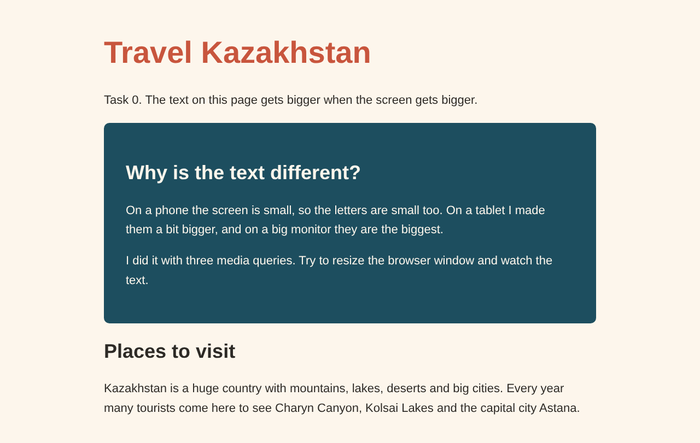

Tablet:

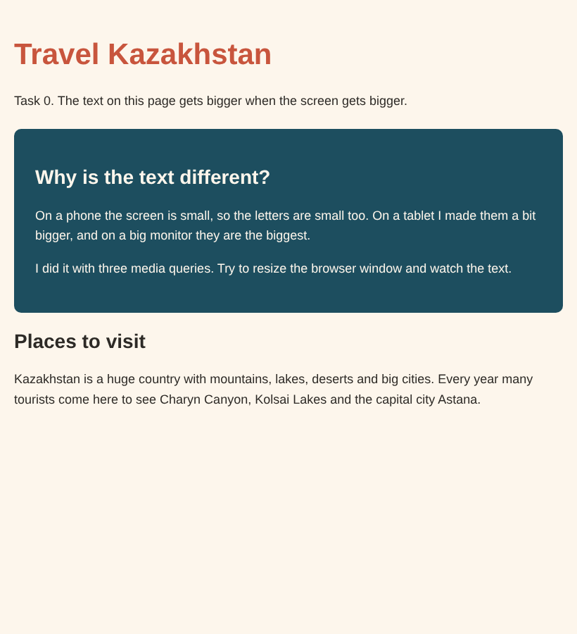

Mobile:

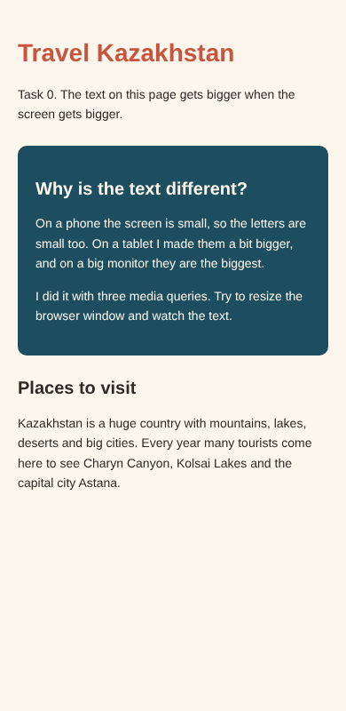

## Task 1. Responsive Layout with Media Queries
Create a webpage with three boxes in a row. Desktop: three in a row. Tablet: two in a row. Mobile: stacked. Use only CSS media queries (no Bootstrap).

Desktop:

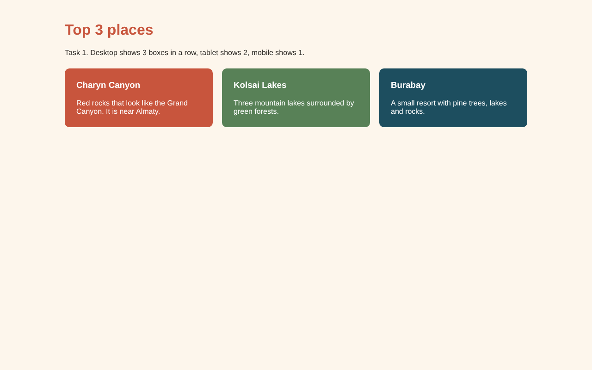

Tablet:

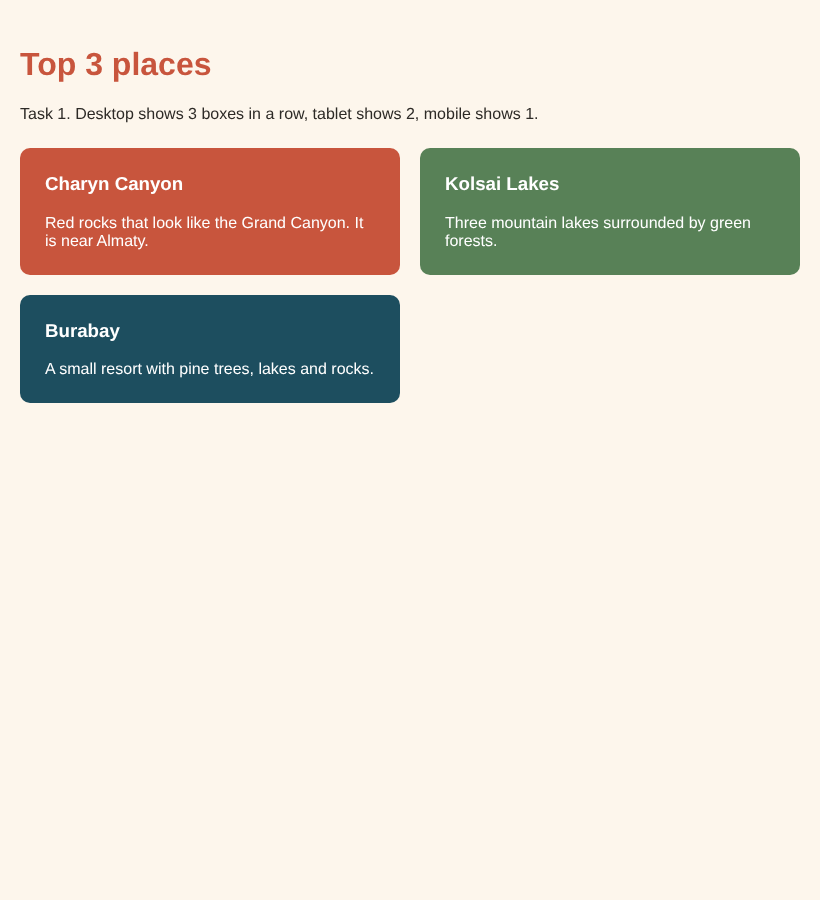

Mobile:

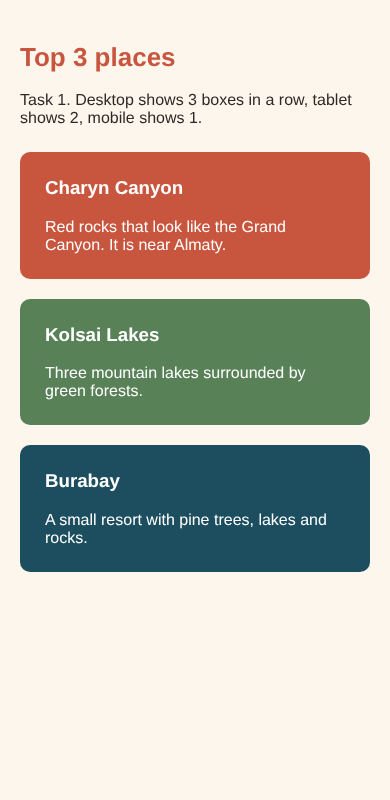

## Task 2. Bootstrap Responsive Columns
Build a layout with Bootstrap 12-column grid. Desktop: 3 columns (4 + 4 + 4). Tablet: two columns on the first row and one on the second. Mobile: all columns stacked.

Desktop:

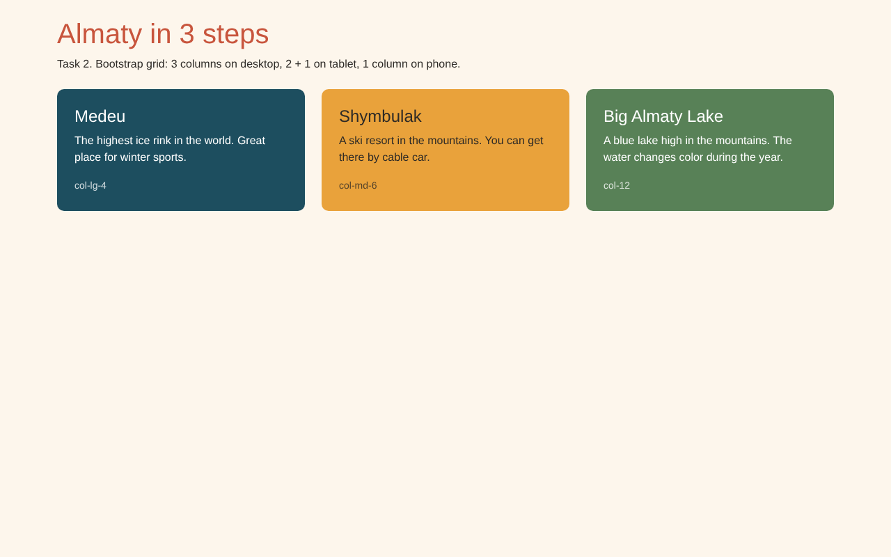

Tablet:

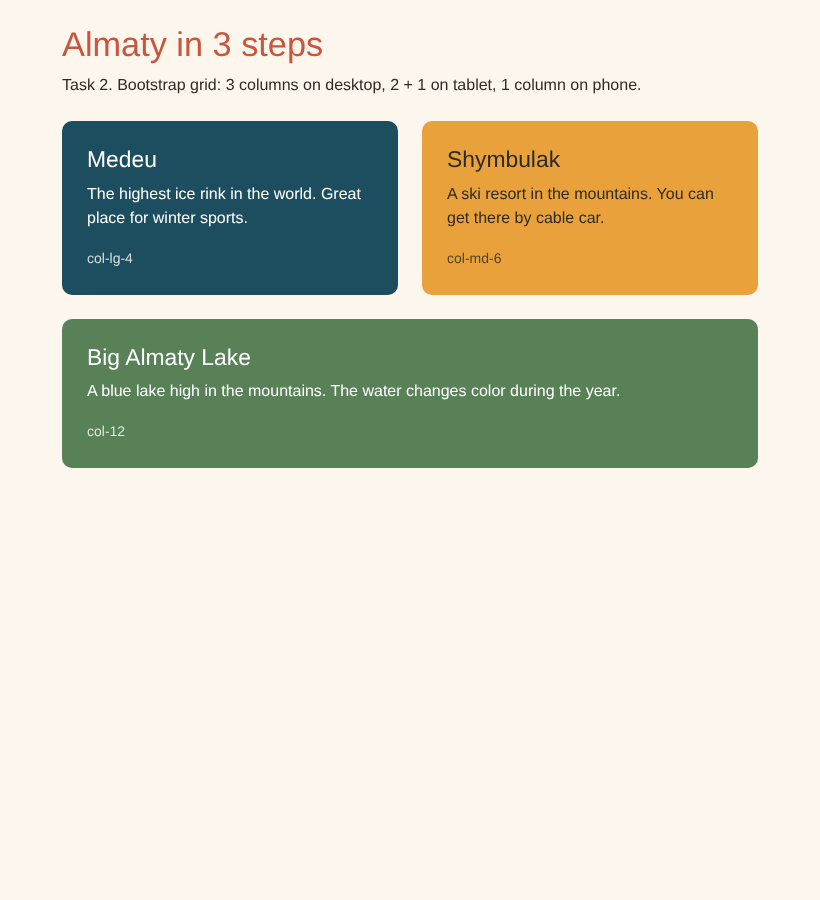

Mobile:

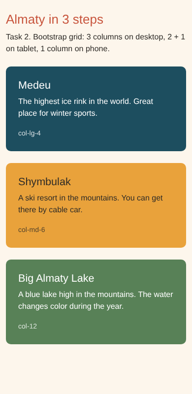

## Task 3. Bootstrap Navigation Bar
Create a responsive navbar: logo on the left, links on the right, hamburger menu on smaller screens.

Desktop:

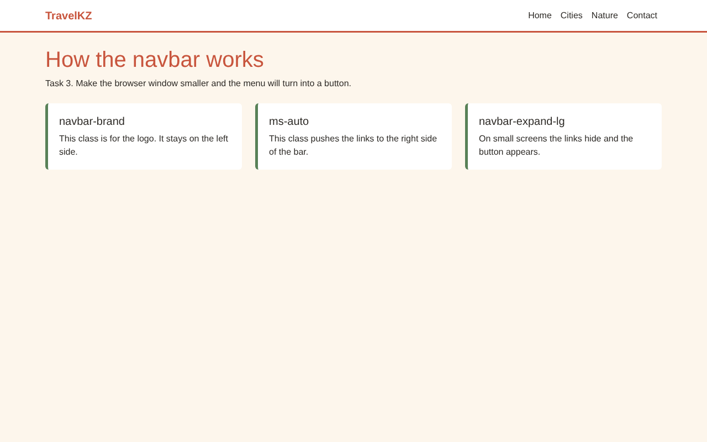

Tablet:

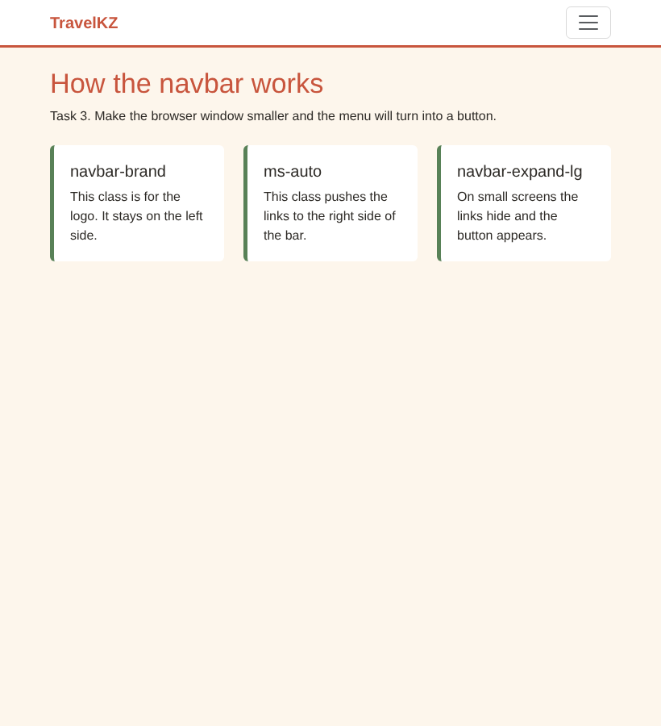

Mobile:

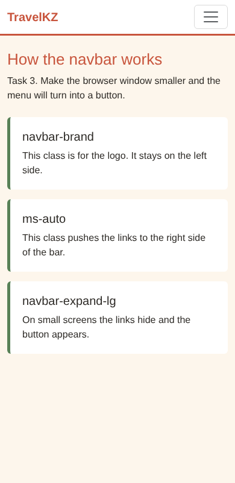

## Task 4. Responsive Portfolio Page
Create a portfolio page with Bootstrap navbar, project cards on the left, sidebar with personal info on the right and a footer. Use custom media queries for font sizes, spacing and visibility.

Desktop:

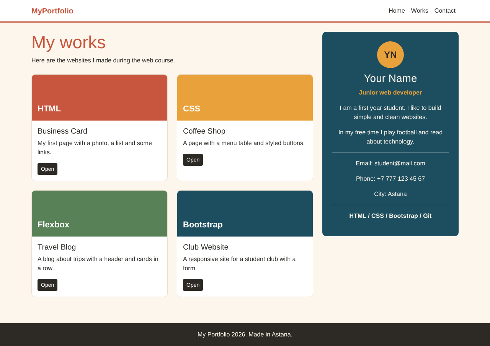

Tablet:

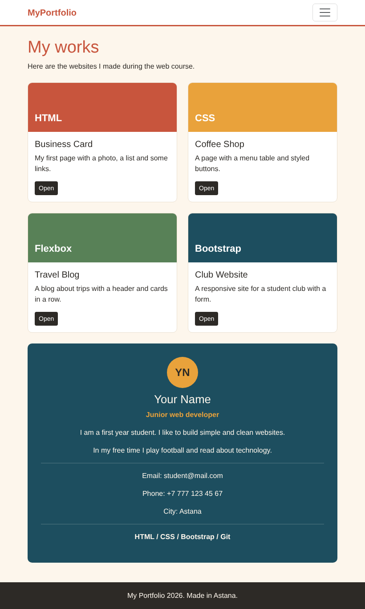

Mobile:

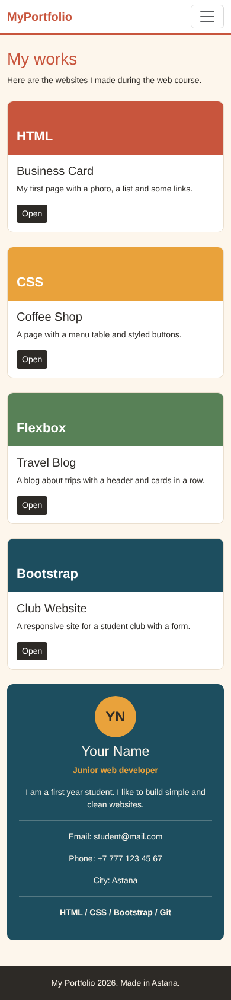

## Summary
I made every task in a separate html file with its own css file in the css folder. I chose travel in Kazakhstan as the theme for the first tasks. In tasks 0 and 1 I used only media queries (min-width for the text and max-width for the boxes). In tasks 2 and 3 I used the Bootstrap grid and navbar. In task 4 I used both Bootstrap and my own media queries. I tested all pages in Chrome DevTools on desktop, tablet and mobile sizes.
